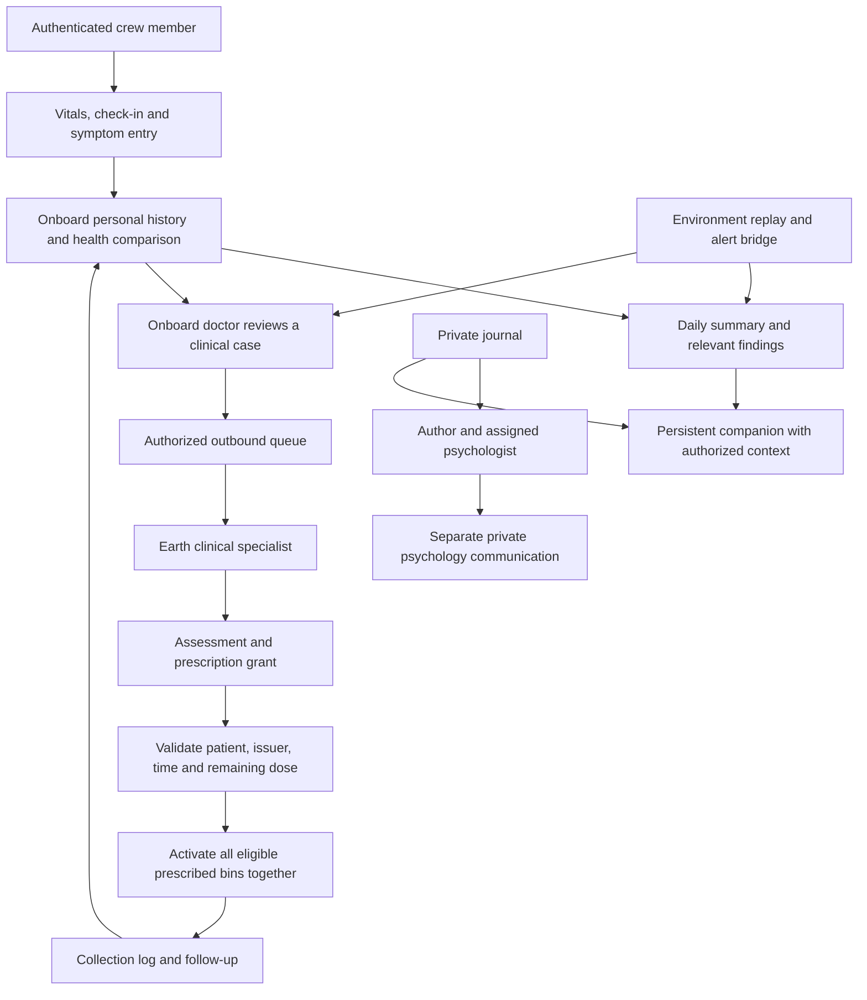

# Ecosystem review and return-from-break handoff

Prepared 2026-11-14 for Tommy from the latest published snapshots below. This is a proposed assembly of the team's existing work and Tommy's requirements, not an adopted common plan or a new UI implementation. zt retains UI and assembly ownership. Read this refresh before the older snapshots in [implementation-tasks.md](implementation-tasks.md).

## Frozen review snapshot

The review includes published branch work even when its PR is not merged. A PR being available does not mean the connection works in main.

| Owner | Reviewed commit / branch | Available now | Connection still needed |
|---|---|---|---|
| zt | `b760d8f`, `zt/ui-skeleton`, merged via #43 | Clickable crew selection, Home, Check-in, Habitat, Med bay, Mind and Companion; fake data and navigation | Actual health inputs/history, environment bridge, inventory, role enforcement and persistent companion |
| angelos | `dc56e60`, `angelos/interactive-check-in`, #25 | Python comparison core, SQLite check-ins, fixed references, weekly analysis, reset/backup, `health-v1` API and JS client; three token-bound synthetic identities | UI wiring, new 1–10 contract, symptoms/journal interfaces, companion implementation and clinical-report role separation |
| dadis2 | `832efca`, `dadis2/prescription-grants`, #44 (builds on #34) | Inventory UI, approvals, RX2 multi-medicine grants, due-dose selection, batch compartment activation, expiry/counters and events | Accepted identity/clock, shared quota enforcement, ground-side QR generation/issuer verification, collection-versus-consumption model and hardware boundary |
| potest | `e9c7079`, `potest/environment-bridge`, #40 | Offline historical replay, synthetic alert exercise, event history, CSV/incident export and snapshot/subscription bridge | App wiring, agreed mission-time mapping and event IDs; delivery queue ownership remains conditional |
| petros_the_space_larper | `f05971a`, research/Mars proposal, #36 | Evidence notes, historical vitals CSV, wellbeing/Mars workflow proposal | Selected fixtures with provenance, field mapping, wellbeing anchors and alignment with latest journal/scale decisions |

No joined product was found in `integration/` or `final/` at this snapshot. `shared/PLAN.md` still lacks the populated idea, scope, owner/backup table and connection agreements. Adopting these needs the normal teammate-approved PR; this review does not silently fill the common plan.

## What was actually seen and checked

- Opened the original zt, dadis2 and potest HTML prototypes from isolated copies of public tracked sources. No teammate's database or working tree was used.
- zt: navigated Home, Check-in and Mind. The current Home's readiness 58 and task count are placeholders. Check-in Save navigates; it does not demonstrate persistence. The Sleep 0–10 placeholder conflicts with sleep hours, and mood/stress/fatigue 0–10 conflicts with Tommy's new 1–10 requirement. Mind's journal/history/support and Companion remain placeholders. The entry scan is a prototype animation, not working biometric authentication.
- dadis2: imported its published sample RX2 code for synthetic crew `c4`. The screen selected two eligible bins together, left other bins inactive and entered batch collection. No camera, real prescription, physical drawer or completed collection was tested. Sender verification is explicitly simulated. This is evidence for DAD-1 availability, not proof of multi-device quota security.
- potest: opened both historical replay and the synthetic exercise, observed alert/recovery history and a missing CO2 reading labelled as a data gap rather than a normal reading. These are demo thresholds, not a reviewed operational protocol.
- Re-ran the latest health suite in isolated temporary storage: **51 discovered, 50 passed, 1 skipped**. The optional JavaScript-client check was skipped because Node was unavailable in this execution environment. The owner's separate full-suite claim is not substituted for this result.
- Invoked the existing health service with fresh synthetic stores and exported daily/history/weekly outputs for review. No generated session token was exported.
- Research findings below describe the repo's supplied data; the source papers were not independently re-audited in this pass.

## Proposed application logic

This is a proposed data flow, not a claim these arrows are implemented. Reports and grants may be delayed; the app must preserve state onboard while disconnected. Approved automatic/periodic routing is separate from doctor-only manual clinical sending. Cadence, triggers and transmission windows still need agreement.

1. Identify the current crew member and their role before reading personal data. Preserve identity when moving between tabs.
2. Home reads the latest available health findings, check-in state and habitat status. Missing or old values remain explicitly missing or old. A nearby environment event supplies context; it does not establish the cause of a symptom.
3. Check-in saves once to the correct person's history, then Home/history refresh from saved data. New mood/stress/fatigue use 1–10; sleep uses hours. Existing 0–10 histories and frozen references need an explicit version/comparison policy before migration.
4. Symptoms need a documented record shared by the relevant modules. They cannot be silently added to `health-v1` check-ins: that API currently rejects unknown fields.
5. The onboard doctor assembles/sends the clinical case using authorized recent health, symptoms and relevant environmental context. The astronaut does not see that report's content. A local clinical queue may hold it offline; an Earth acknowledgement and reply must be distinguishable from merely having queued it.
6. Earth assessment/prescription returns to the correct patient. One reusable course QR/code selects all and only currently due authorized compartments. Expiry and per-dose limits prevent repeated scans from creating new allowances. Collection and actual consumption need distinct agreed semantics.
7. Journal text and private derived details remain outside ordinary medical reports and crew views. Human readers are its author and assigned psychologist. The author's companion may process this context without granting another human access.
8. The companion explains available context and helps navigate/enter information; it does not prescribe, authorize drawers or invent data. Its model, storage and offline behavior have not yet been delivered.

## Reports: an important naming and permission boundary

The current `GET /v1/me/report` returns **weekly personal analytics** to the authenticated crew member. It is not the doctor-only clinical case report Tommy described for Earth.

Updated after Tommy’s follow-up on visibility:

- **Detailed personal history/weekly analysis:** not shown to the astronaut, per Tommy’s follow-up. Relevant assigned healthcare professionals may access it; this is not permission for general crew access. The basic daily Home summary is separate and its exact fields remain to be agreed.
- **Clinical case report to Earth:** doctor-only manual creation/send; content hidden from the astronaut, per Tommy's Q13 answer.
- **Private psychology journal/message:** author/assigned psychologist, with authorized own-assistant processing; separate recipient and queue permissions.

Do not wire `/v1/me/report` into a clinical-send button or claim it already enforces doctor-only access. Tommy has now confirmed that the weekly analysis should also be hidden from the astronaut: the current crew-token API must change; naming or hiding buttons alone cannot enforce this. Whether the astronaut gets a content-free clinical delivery notice is still open.

## Role boundaries to preserve

| Capability | Current intended audience/actor | Still to specify |
|---|---|---|
| Daily Home/check-in versus detailed history/analysis | Astronaut has the agreed basic Home/input flow; detailed history/weekly analysis belongs to assigned healthcare roles | Exact Home fields and clinician-facing API enforcement; journal privacy still applies |
| Manual clinical case report | Onboard doctor creates/sends; Earth clinical recipient evaluates | Exact fields, time window, notification and routing/consent rules |
| Private journal | Author + assigned psychologist; own assistant can process it | Storage/API and leak prevention for summaries/derived details |
| Routine restricted inventory access | Agreed onboard-doctor categories; Earth for specified categories | Approved category/protocol list and verified grants |
| Emergency path | All crew, exceptionally, including doctor-incapacitation scenario | Eligibility, confirmation, logging and later review protocol |
| Habitat readings | Relevant crew/app views | Incident routing and which clinical packets include which intervals |

These are product boundaries to implement and test, not evidence that current query-string demo identities provide authentication.

## Existing connection points: use them rather than rebuilding

| Boundary | Existing handoff | Acceptance test before calling it joined |
|---|---|---|
| Health to UI | `health_monitor/app_api.py`, `health_client.mjs`, `API_CONTRACT.md`; `health-v1` envelopes | Save, reload and display history for A; switch to B without reading/writing A; show gaps; reject invalid inputs |
| Environment to UI/report | `environmentMonitor.getSnapshot()` and `.subscribe()`; bridge section in environmental README | Alert appears once, recovery/reset handled, missing feed stays missing, historical source time is preserved |
| Inventory to UI/report | `MedInventory.importGrant`, `grants`, `dueCompartments`; `medinventory` compartment/collection events | Two due bins together, unrelated bin excluded, repeat dose rejected, later valid dose accepted; wrong patient/expired grant blocked |
| Doctor to Earth and back | No connected end-to-end clinical transport demonstrated | Queue offline, persist/restart, deliver once after reconnect, acknowledge, receive correct-patient assessment/grant |
| Journal/companion | UI placeholders and agreed concept; no complete service | Save/reload private note, authorized context only, no leak into ordinary medical reports |

For same-page/iframe integration, accept the owners' documented lifecycle and origin requirements. A visual embed alone is not a completed data connection.

## Data available for the review

The health synthetic example produced by the existing service contains resting heart rate **75 vs reference median 61 bpm**, sleep **5.8 vs 7.8 hours**, mood **4 vs 7**, stress **6 vs 3**, fatigue **6 vs 3**, with two consecutive flagged days. The self-report values currently follow the module's old **0–10** contract. These are synthetic comparison outputs and unvalidated demo rules, not a clinical diagnosis or a new readiness formula.

Petros's historical CSV contains **47 rows**: 26 individual summaries, 16 cohort means, 3 cohort medians, 1 approximate cohort summary and 1 unavailable-values record. Populated measurements include heart rate in 31 rows, respiratory rate in 7, SpO2 in 5, blood pressure in 11 and core temperature in 4. These mixed subjects, observation types and missions cannot silently become one astronaut's continuous baseline. Keep them as labelled reference material; choose explicit synthetic longitudinal fixtures where needed for the connected demo.

## Return-from-break tasks — proposed, not assumed accepted

| Owner | First concrete task | Definition of done | Then |
|---|---|---|---|
| zt | Accept existing health/environment/inventory contracts and create the first joined connection in `integration/`, using copies/adapters under ownership rules | README with one launch path; identity preserved; check-in persists and refreshes Home; habitat snapshot/alert and inventory events visible; fake values clearly separated | Role-specific clinical view, journal/companion entry, final layout; clinical transport needs an agreed owner |
| angelos | Review/adjust ANG-1 for the agreed new 1–10 version and zt wiring; distinguish personal analytics from the clinical case | Versioned input/output examples; old baseline/history preserved; A/B isolation and UI reload pass; no astronaut clinical-send capability implied | ANG-2: minimal authorized companion/journal context, with explicit model/runtime and persistence scope |
| dadis2 | Integrate/review delivered DAD-1 rather than rebuild; demonstrate dose reuse/expiry and define shared-counter boundary with zt | Correct-patient two-bin flow, duplicate and later-dose cases, collection versus consumption semantics, explicit simulated issuer/lock behavior | DAD-2 ground code/QR output and issuer contract; emergency protocol implementation after team agreement |
| potest | Help zt consume delivered POT-1 with accepted clock/event mapping | One incident propagates once; source time/provenance retained; gap, recovery and replay reset handled | POT-2 persistent delivery queue only if ownership is accepted; do not assume it is already assigned |
| petros | Deliver a small selected fixture package and exact field/unit/source table, plus wellbeing form anchors | Every demo field is traceable or labelled synthetic; no cohort-to-person baseline mixing; new self-reports 1–10, sleep hours; journal rule aligned | Select relevant background evidence and demo/submission explanation, rather than expanding broad research indefinitely |
| Tommy with zt/owners | Resolve the small set of shared product/contract choices below and review the connected story | Choices recorded with relevant owners; shared plan updated via teammate-reviewed PR when adopted | Review the first joined demo against the story; keep concepts and implementation distinct |

ANG-1, DAD-1 and POT-1 are **available for integration review**, not empty tasks. The older handoff's first snapshot predates these deliveries. The highest-value next work is joining and verifying them.

## Decisions needed before the first joined demo

1. **Identity and roles:** reconcile health `demo-001..003`, zt `crew=1..3` and inventory `c1..c4`. Choose one explicit mapping and identify onboard doctor/psychologist/Earth identities. Do not infer that similarly named crew represent the same patient.
2. **Time:** one mission clock for synthetic crew data, plus separate archival source time and any explicit mapping. No 2018 replay silently becomes a simultaneous 2026 patient observation.
3. **Scales/fields:** mood/stress/fatigue 1–10 migration/version strategy; sleep hours; agreed symptom record and wellbeing privacy for derived values.
4. **Reports/transport:** personal analytics versus hidden clinical report, exact content/window/triggers/cadence, transport owner, retry/deduplication and acknowledgement behavior.
5. **Prescription protocol:** category approvals, quota scope/shared state, due-time handling, collection/consumption, emergency eligibility and log/review rules.
6. **Entry and Home:** first-demo identity/login flow; decide readiness with zt. Until defined, the draft score 58 is a labelled placeholder, not a calculated health indicator.
7. **Demo story:** choose the minimum connected scenario and who demonstrates Earth/onboard-doctor actions. The current crew-A/B/C drafts are starting material, not adopted test cases.

Suggested review story for Tommy to accept or edit: a crew member checks in, sees the stored change, adds a symptom; the doctor reviews contextual data and queues a clinical case while offline; reconnect delivers it once; a simulated Earth reply supplies a grant; only its due bins become available and repeated collection is denied. Review a private journal/companion interaction separately so its privacy boundary is visible. This orders existing team concepts; it adds no treatment recommendation.

## Can wait

Points, customization and gamification remain deferred. Biometrics, physical lock hardware, a trained/offline conversation model and a validated readiness formula are not implied by a clickable prototype. Do not let these block the first agreed connection unless the team changes demo scope.

## Handoff order

1. Tommy reviews this proposed ecosystem and resolves the product questions one at a time.
2. zt and relevant owners accept the smallest shared contracts and an integration owner/backup.
3. Join one vertical flow and run the acceptance checks above before broad visual polish.
4. Record adopted cross-owner decisions in new `shared/decisions/` files; propose the populated common plan through a teammate-approved PR.
5. Update each owner's own status with accepted work and next steps. This review has not edited or assigned work inside anyone else's folder.

## Pill dispenser option raised during review

Tommy asked about metering prescribed pills without exposing the stock package. See the follow-up in [plan.md](plan.md) for sources and engineering caveats. It is under investigation, not adopted or implemented. If accepted, batch authorization would activate dose outlets rather than unlock full pill cartridges; the prescribed count, confirmed delivery, fault/restart handling and collection-versus-consumption distinction need a revised contract with dadis2/zt.
